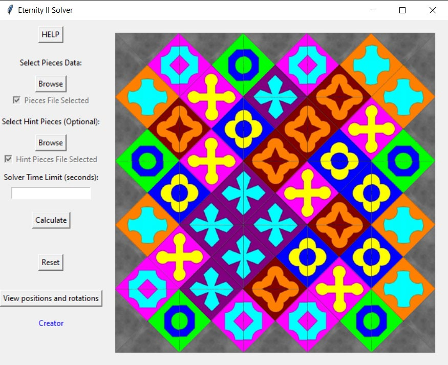

# Eternity II Puzzle Solver

**EII-MILP-solver** is a Python application for solving Eternity II-style edge-matching puzzles through integer linear programming. It combines a binary MILP model built with **PuLP**, the **CBC solver**, and a **Tkinter interface** for loading puzzles, setting fixed-piece hints and visualizing the resulting arrangement.



*The interface displaying a solved 5 × 5 Eternity-style instance with fixed-piece hints, as illustrated in the project report.*

## Model and Features

- **Placement and rotation:** binary variables select a board position and one of four rotations for each piece. Every piece is used once and every cell contains one piece.
- **Edge matching:** the objective minimizes mismatched internal edges, while the outer border is constrained to colour `0`.
- **Optional hints:** selected pieces can be fixed to specified positions and orientations.
- **Inspection and export:** display the arrangement, highlight mismatches in red, inspect positions and rotations, and save result statistics.

## Quick Start

Use Python 3.10-3.12 with Tkinter available:

```bash
git clone https://github.com/PanosLelakis/EII-MILP-solver.git
cd EII-MILP-solver
python -m pip install -r requirements.txt
python eii.py
```

Run from the repository root so the application can find its image assets, help file and output folder.

1. Under **Select Pieces Data**, click **Browse** and choose **pieces_set_1/pieces_03x03.txt** for a small first example.
2. Optionally select a matching file under **Select Hint Pieces (Optional)**. Bundled hints are provided in **hints_for_set_1/**.
3. Optionally enter a positive integer under **Solver Time Limit (seconds)**. Leave it empty for no CBC search limit.
4. Click **Calculate**, then use **View positions and rotations** to inspect the arrangement. Use **Reset** before loading another example.

The interface waits while the solver runs. The time limit applies to CBC search; model construction takes additional time. Larger instances can require substantial computation, and a time limit does not guarantee a fully matched board.

## Input and Output

- **Piece files:** the first line contains `rows columns`; each subsequent line defines a piece as `left top right bottom`. Piece IDs follow file order, starting at `0`. Colour `0` represents the grey border.
- **Hint files:** each line contains `piece row column rotation`. Indices start at `0`; rotations `0-3` represent clockwise quarter-turns.
- **Saved results:** `results/results_<rows>x<columns>.txt` contains the piece layout, matching/mismatching edge counts and solving time. Repeating a board size overwrites that file. Run statistics are appended to **log.txt**.

Two collections of puzzle instances are included in **pieces_set_1/** and **pieces_set_2/**.

## Report and Reference

[Read the project report (PDF, in Greek)](Eternity%20II%20-%20%CE%AD%CE%BA%CE%B8%CE%B5%CF%83%CE%B7.pdf).

Model reference: Salassa et al., *MILP and Max-Clique based heuristics for the Eternity II puzzle* (2017). [Paper](https://arxiv.org/abs/1709.00252).

My contribution includes the Python/PuLP implementation, CBC integration, graphical interface, hint handling, visualization and experimental evaluation.

## License

Available for personal study and non-commercial academic evaluation under the [Academic Evaluation Source License](LICENSE). See the license for the complete terms.
